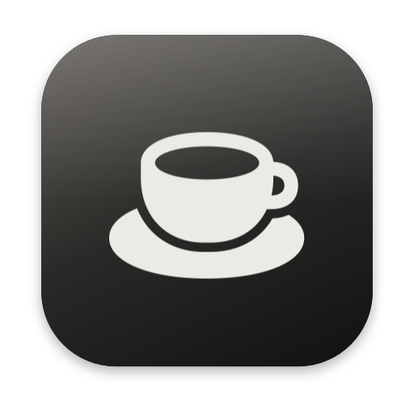
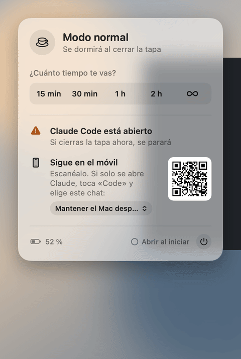
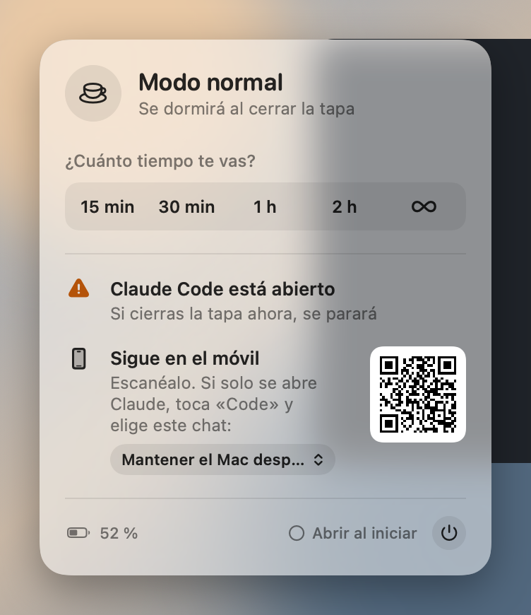
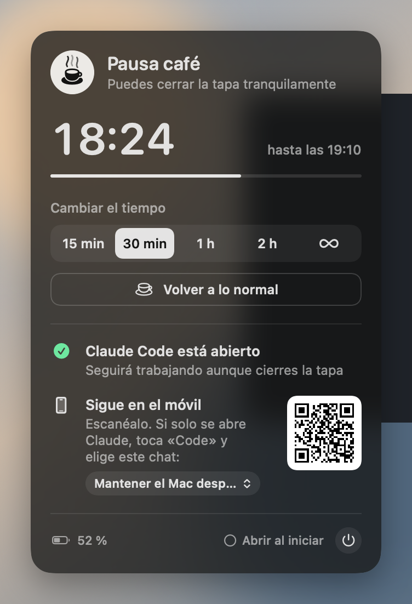

<p align="center">
  
</p>

<h1 align="center">Despierto ☕</h1>

<p align="center">
  <b>Vete a por un café. Tu Mac (y tu IA) siguen trabajando.</b><br>
  Una mini app para la barra de menú de macOS que mantiene tu Mac encendido aunque cierres la tapa.
</p>

<p align="center">
  
  <br><sub>Animación dibujada por la propia app (el fondo de escritorio es simulado).</sub>
</p>

## ¿Para qué?

Estás vibecodeando con **Claude Code**, **Codex** o **Cursor**, te apetece un café y cierras el portátil… y la sesión se corta. 😩

Con Despierto eliges cuánto tiempo te vas, cierras la tapa y todo sigue funcionando. Y si quieres, **continúas el chat desde el móvil**.

## Qué hace

- **☕ Pausa café**: elige 15 min, 30 min, 1 h, 2 h o sin límite. Cuando se acaba el tiempo, el Mac vuelve solo a lo normal, aunque la tapa siga cerrada.
- **⏱ Cuenta atrás en la barra de menú**, para que sepas cuánto te queda.
- **🤖 Vigila Claude Code**: si está abierto y no has activado Despierto, te avisa de que se parará si cierras la tapa.
- **📱 Sigue en el móvil**: un código QR para abrir Claude en el móvil y continuar tus sesiones de Claude Code.
- **🔋 Batería a la vista**, con aviso si vas con poca y sin cargador.
- **🪟 Cristal transparente**: claro en modo normal y ahumado en negro ceniza cuando está activado. Funciona en modo claro y oscuro.
- **✨ Animado con calma**: al activarlo, la taza se llena y el vapor se dibuja y sube en bucle. Respeta «Reducir movimiento» de macOS.
- Opción de **abrirse al iniciar sesión**.

<p align="center">
  
  &nbsp;
  
</p>

| Icono arriba | Qué significa |
|---|---|
| Taza vacía | Normal: el Mac se duerme al cerrar la tapa |
| Taza humeante | Despierto: puedes cerrar la tapa |
| Taza humeante + 18:24 | Pausa café: tiempo que queda |

## Instalación

Necesitas macOS 13 o posterior y las herramientas de Xcode (`xcode-select --install`).

```bash
git clone https://github.com/laulys/despierto.git
cd despierto
./build.sh
open build/Despierto.app
```

Si la vas a usar a diario, arrastra `build/Despierto.app` a **Aplicaciones** y marca «Abrir al iniciar».

## Seguir el chat en el móvil 📱

Usa **Remote Control** de Claude Code: tus sesiones del Mac aparecen en la app de Claude del móvil (o en [claude.ai/code](https://claude.ai/code)) y puedes seguir escribiendo desde ahí.

- **En la app de escritorio de Claude**: activa *Settings → Claude Code → Connect new sessions to Remote Control*.
- **En la terminal**: escribe `/remote-control` dentro de una sesión (el panel tiene un botón para copiarlo) o empieza con `claude --remote-control`.

El QR de Despierto lleva al chat que está trabajando (o al más reciente). Si tienes varios conectados, pulsa su nombre para elegir otro.

> **Si el móvil solo abre la app de Claude:** es un fallo conocido de la app con los enlaces de Remote Control (también pasa con el QR oficial de Claude Code). Entra en la pestaña **Code** y elige el chat con el nombre que muestra Despierto.

El Mac tiene que seguir encendido para que la sesión funcione. Para eso está Despierto. 😉

## Cómo funciona

Por debajo usa el comando de macOS:

```bash
sudo pmset -a disablesleep 1   # no dormir al cerrar la tapa
sudo pmset -a disablesleep 0   # volver a lo normal
```

Como es un ajuste del sistema, **la primera vez** macOS te pide tu contraseña. Con ella, Despierto instala un permiso que **solo** sirve para esos dos comandos (`pmset -a disablesleep 0` y `1`) y lo comprueba con `visudo` antes de guardarlo. Después ya no te la vuelve a pedir, ni siquiera para el temporizador. La app nunca ve ni guarda tu contraseña: la pide el propio sistema.

¿Prefieres que te la pida siempre? Borra el permiso:

```bash
sudo rm /etc/sudoers.d/despierto
```

El temporizador de la pausa café lo lleva un pequeño proceso del sistema. Por eso funciona aunque cierres la tapa o salgas de la app.

Todo el código está en [`main.swift`](main.swift), con comentarios en español. El icono se dibuja con [`icon.swift`](icon.swift).

## ⚠️ Ojo

- **No metas el Mac en la mochila** con el modo despierto activado: se puede calentar mucho.
- Con la tapa cerrada sigue gastando batería, así que mejor enchufado.
- Si eliges **∞ (sin límite)**, acuérdate de volver a lo normal.

## Ideas para seguir

- Aviso en el móvil cuando la IA termine.
- Atajo de teclado global.

---

Vibecodeado con [Claude Code](https://claude.com/claude-code).
